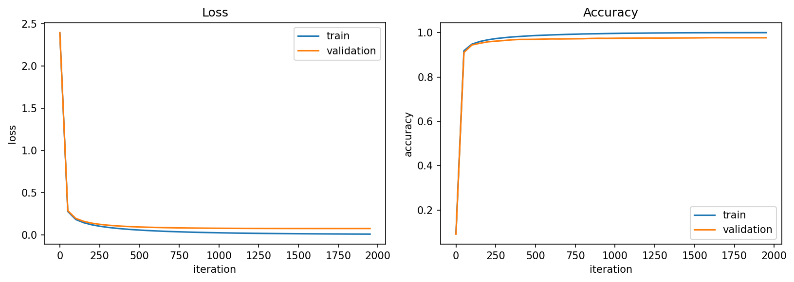
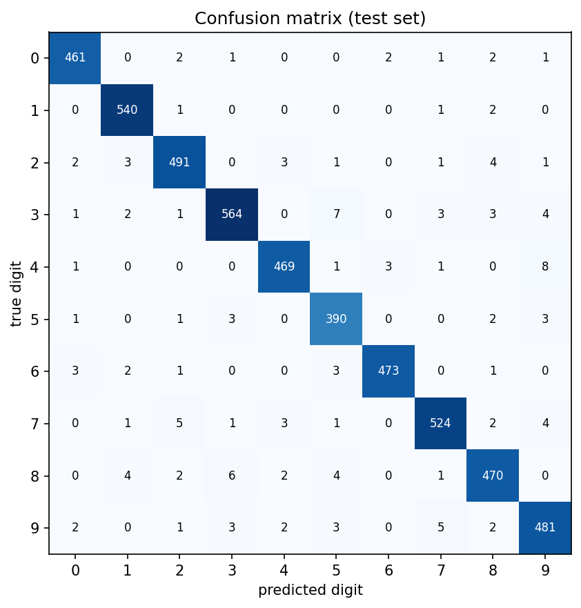
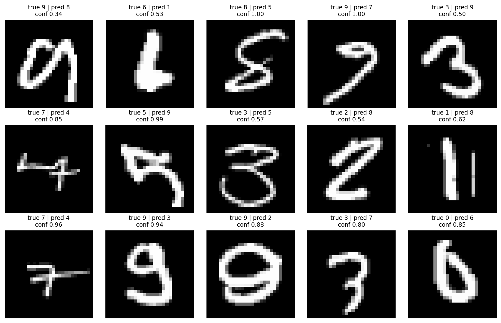

# Digit Classifier from Scratch

A handwritten digit classifier built with only NumPy, pandas and matplotlib. No TensorFlow, PyTorch or scikit-learn is used for the model. Forward propagation, backpropagation and gradient descent are all written by hand and checked against a numerical gradient check.

## Overview

- Input: 28 x 28 grayscale images, flattened to 784 pixels
- Network: 784 -> 256 (ReLU) -> 10 (softmax)
- Loss: cross-entropy
- Training: full-batch gradient descent, keeping the weights with the lowest validation loss
- Output: one probability per digit 0-9, and the prediction is the argmax

## Dataset

The data is the [Kaggle Digit Recognizer](https://www.kaggle.com/c/digit-recognizer) `train.csv`: 42,000 labeled images, where the first column is the label and the other 784 columns are pixel values from 0 to 255.

The Kaggle `test.csv` has no labels, so it is not used. Instead, `train.csv` is shuffled (seed 42) and split into:

| Set | Images | Purpose |
|---|---|---|
| Train | 32,000 | Fit the weights |
| Validation | 5,000 | Monitor training and pick the best checkpoint |
| Test | 5,000 | Final evaluation |

The CSV is not included in this repository. Join the [Digit Recognizer competition](https://www.kaggle.com/c/digit-recognizer) (needed to accept its rules), then either download `train.csv` manually or run:

```bash
kaggle competitions download -c digit-recognizer -f train.csv
```

Place the file at `data/train.csv`.

## Project structure

```
.
├── data/
│   └── train.csv        (download from Kaggle, not committed)
├── outputs/
│   ├── weights.npz
│   ├── results.json
│   ├── history.csv
│   └── *.png
├── mnist.ipynb
├── requirements.txt
├── LICENSE
└── README.md
```

`outputs/` holds the files produced by the final training run, which was done in a Kaggle notebook.

## Setup

Requires Python 3.9 or newer.

```bash
python -m venv .venv
source .venv/bin/activate        # Windows: .venv\Scripts\activate
pip install -r requirements.txt
mkdir data
```

Put `train.csv` in `data/`, open `mnist.ipynb` in VS Code or Jupyter, and run all cells from top to bottom. The notebook also runs on Kaggle, where it finds the competition data on its own.

The final run took about 523 seconds (roughly 9 minutes) for 2000 iterations with 256 hidden neurons on a 4-core Kaggle CPU session (see `outputs/results.json`). Expect different timings on your machine. Running the notebook again overwrites the files in `outputs/`.

## Notebook walkthrough

| Step | What it does |
|---|---|
| 1 | Imports and creates the `outputs/` folder |
| 2 | Loads the CSV, shuffles (seed 42), splits, scales pixels to 0-1, transposes to `(784, m)` and one-hot encodes labels to `(10, m)` |
| 3 | Plots sample digits |
| 4 | `init_params`, `relu`, `softmax`, `forward_prop` |
| 5 | `compute_loss`, `get_predictions`, `get_accuracy`, `evaluate` |
| 6 | `backward_prop` |
| 7 | `update_params` |
| 8 | Numerical gradient check on non-zero gradient entries, with an assertion on the relative difference |
| 9 | Training function and training run, logging every 50 iterations and keeping the weights with the lowest validation loss |
| 10 | Loss and accuracy curves |
| 11 | Final train and validation accuracy |
| 12 | Test set evaluation |
| 13 | Confusion matrix |
| 14 | Misclassified digits |
| 15 | Saves weights, history and metrics to `outputs/` |
| 16 | Reloads the weights and predicts a single image |

### Forward propagation

$$A^{[0]} = X$$

$$Z^{[1]} = W^{[1]} A^{[0]} + b^{[1]}$$

$$A^{[1]} = \mathrm{ReLU}(Z^{[1]})$$

$$Z^{[2]} = W^{[2]} A^{[1]} + b^{[2]}$$

$$A^{[2]} = \mathrm{softmax}(Z^{[2]})$$

Softmax is computed per column, after subtracting the column maximum for numerical stability.

### Loss

$$J = -\frac{1}{m} \sum Y \log A^{[2]}$$

In the code, `1e-8` is added inside the log to avoid `log(0)`.

### Backward propagation

$$dZ^{[2]} = A^{[2]} - Y$$

$$dW^{[2]} = \frac{1}{m} dZ^{[2]} A^{[1]T}$$

$$db^{[2]} = \frac{1}{m} \sum dZ^{[2]}$$

$$dZ^{[1]} = W^{[2]T} dZ^{[2]} \odot g'(Z^{[1]}), \quad g'(Z^{[1]}) = (Z^{[1]} > 0)$$

$$dW^{[1]} = \frac{1}{m} dZ^{[1]} X^T$$

$$db^{[1]} = \frac{1}{m} \sum dZ^{[1]}$$

### Parameter update

$$W^{[l]} := W^{[l]} - \alpha \, dW^{[l]}, \qquad b^{[l]} := b^{[l]} - \alpha \, db^{[l]}$$

where `alpha` is the learning rate.

### Shapes

| Array | Shape |
|---|---|
| `X`, `A0` | (784, m) |
| `Y` | (10, m) |
| `W1` | (n_h, 784) |
| `b1` | (n_h, 1) |
| `Z1`, `A1` | (n_h, m) |
| `W2` | (10, n_h) |
| `b2` | (10, 1) |
| `Z2`, `A2` | (10, m) |

Each gradient has the same shape as the parameter it updates.

## Training details

| Setting | Value |
|---|---|
| `hidden_size` | 256 |
| `alpha` | 1.0 |
| `iterations` | 2000 |
| Weight init | `randn * sqrt(2 / n_inputs)` |
| Bias init | zeros |
| Data type | float32 |

### How the settings were chosen

These notes come from earlier experiments with a 128-neuron network on the same kind of split, judged on validation accuracy only. The experiment code is not part of this repository:

- Over 200 iterations, `alpha` = 1.0 beat 0.5, 0.1 and 0.05. A smaller learning rate did not give a better fit, only slower progress.
- With `alpha` = 1.0 and 128 neurons, validation accuracy flattened out at around 97.4% to 97.5% by about 1000 iterations, while train accuracy kept rising.
- A 10-neuron network at `alpha` = 1.0 failed (about 11% validation accuracy) because almost all hidden neurons died: their `Z1` went negative for every image, so ReLU gave 0 and the gradient `(Z1 > 0)` was 0. At `alpha` = 0.1 the same network reached about 91% with no dead neurons. The best learning rate depends on network size.

The final configuration (256 neurons, 2000 iterations) was chosen to give the model more capacity and time to reach its plateau. This repository contains only that final configuration. The saved weights are the checkpoint with the lowest validation loss.

## Results

| Metric | Value |
|---|---|
| Best checkpoint (iteration) | 1850 |
| Train accuracy | 0.9998 (6 wrong out of 32,000) |
| Validation accuracy | 0.9768 |
| Test accuracy (5,000 images) | 0.9726 (137 wrong) |
| Test loss | 0.0905 |

Validation loss stops improving after about iteration 1500, so the best checkpoint at 1850 is only marginally better than the ones around it. The gap between train accuracy (99.98%) and validation accuracy (97.68%) shows the model overfits, which is why L2 regularization and dropout appear under possible improvements.

The test set was used for the final evaluation only. No settings were changed after looking at it, but I did inspect its errors in the confusion matrix and the misclassified digits below.







## Common bugs to watch for

- Forgetting the `1/m` factor in the gradients, which makes them `m` times too large
- Softmax or sum over the wrong axis (softmax uses `axis=0`, the bias gradient sum uses `axis=1`)
- Shape mismatches from a missing transpose, so `X` must be `(784, m)`
- Biases of shape `(n,)` instead of `(n, 1)`
- Starting loss far above about 2.3 (`-log(0.1)`, the loss of a uniform guess). He initialization can start a bit higher, so only treat a much larger value as a bug
- Not re-assigning the weights returned by `update_params`

## Possible improvements

- Mini-batch gradient descent
- Adam or momentum
- L2 regularization or dropout
- A second hidden layer
- Data augmentation, or a convolutional network

## Acknowledgements

Dataset: [Kaggle Digit Recognizer](https://www.kaggle.com/c/digit-recognizer), derived from the MNIST database by Yann LeCun et al.
